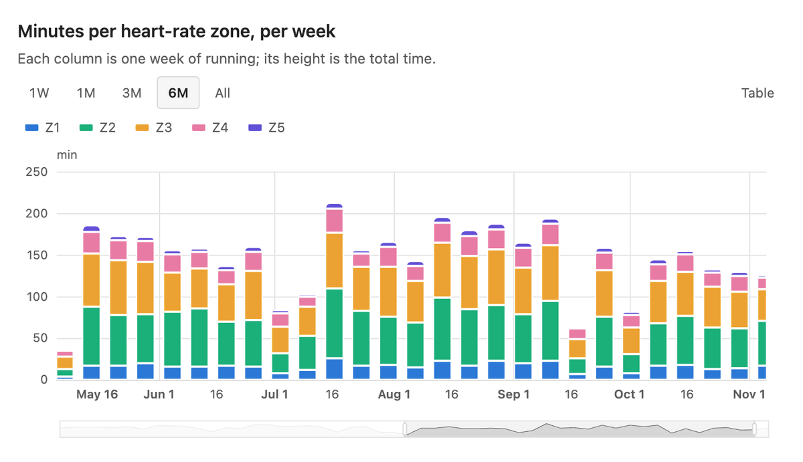
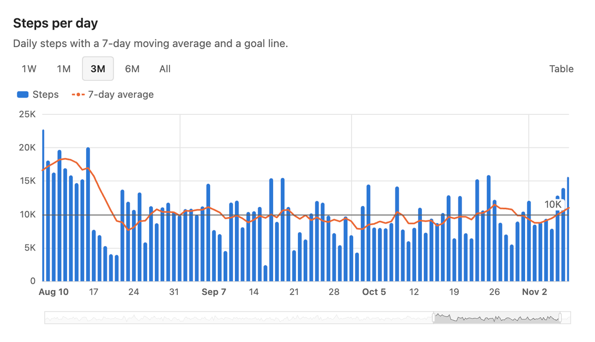
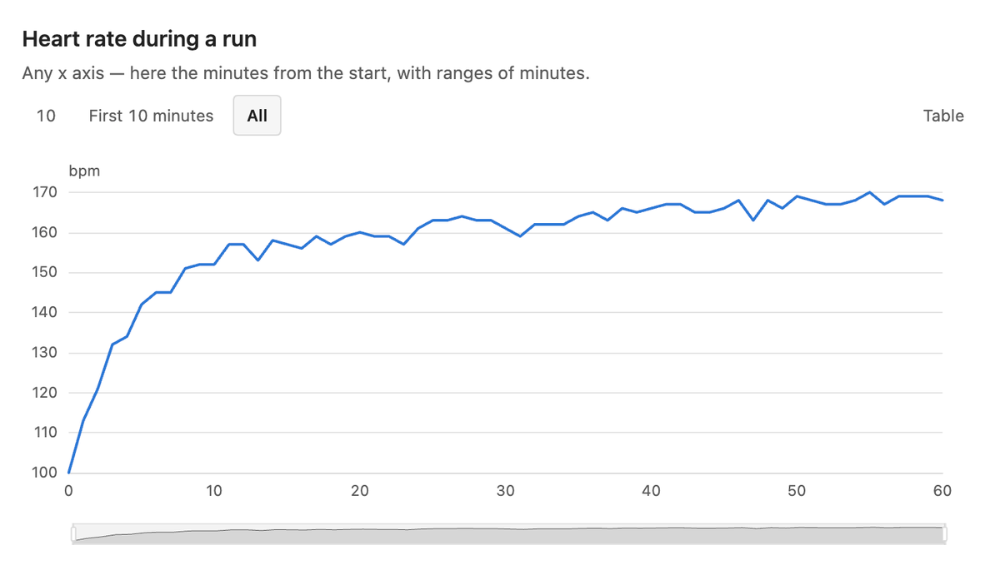
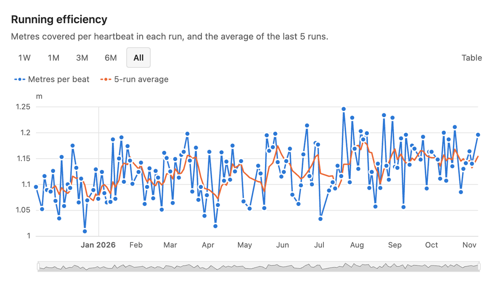
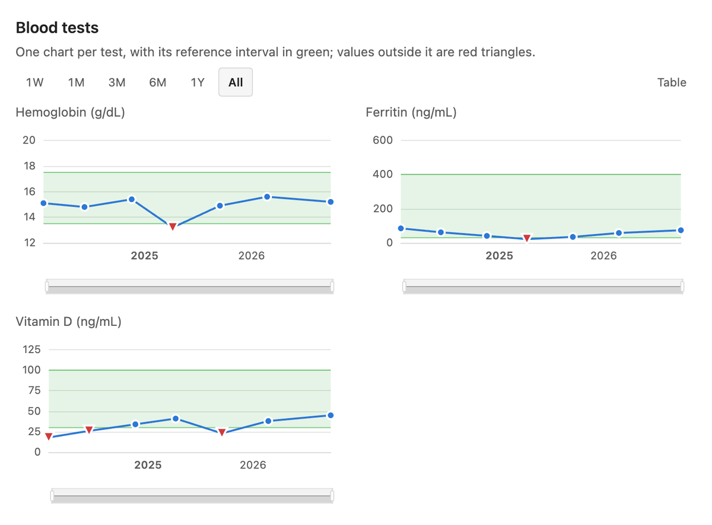
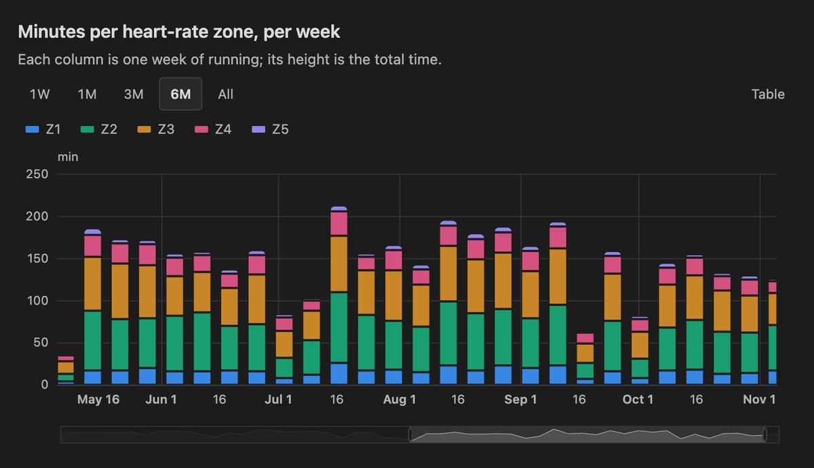

# Data Charts for Obsidian

Interactive, responsive charts of the data files in your vault — CSV, JSON and JSON Lines — written as a small YAML block in any note.

- **Any x axis**: dates (a time axis), numbers or names, detected from the data.
- **Range buttons**: `1W`, `1M`, `3M`, `6M`, `1Y`, `3Y`, `YTD`, `All` on a time axis; the last N units or categories, or named windows, on any axis. Buttons that would show everything are left out. Charts of a `group` in a note share their range.
- **Zoom and pan**: ⌘/Ctrl + wheel, trackpad or touch pinch, drag, and a slider.
- **Series**: lines, areas, bars, points, stacked bars with their total; moving averages by points or by time (`7d`); aggregation by day, week, month or year; expressions (`distance_km * 1000 / (hr_avg * duration_min)`).
- **A readable time axis**: days, weeks, months or years as the window and the width allow; the first label of each month names it, hairlines mark where months begin, and weekly or monthly totals are labelled under their bar.
- **Descriptions**: a few lines of Markdown under the title, to say what the chart shows and how to read it.
- **Reference bands**: a green range from two fields of each row (lab reference intervals) or two numbers (a target); points outside it are red triangles pointing up or down, and the tooltip says so.
- **Small multiples**: `facet` draws one chart per value of a field (one per lab test, per sport…), zooming together.
- **Tables**: a table view of every chart, and `type: table` for rows filtered by the note itself (`where: date == this.Date`).
- **Live**: a chart redraws when its files change — an import running in the background updates the note you are reading.
- **Theme**: colors, fonts and dark mode follow Obsidian; a color-blind-safe palette; works on iPhone and iPad.

Data files are read from the vault and never leave it.



*The screenshots show Obsidian's default theme and synthetic data.*

## A first chart

````markdown
```data-chart
title: Steps per day
description: Daily steps with a 7-day moving average and a goal line.
source: Data/daily.csv
x: date
range: 3M
series:
  - {y: steps, name: Steps, type: bar, goal: 10000}
  - {y: steps, name: 7-day average, rolling: 7d}
```
````

`Data/daily.csv`:

```csv
date,steps
2026-03-01,8123
2026-03-02,10456
```



## The block

| Key | | Example |
| --- | --- | --- |
| `source` | File, list of files, or pattern (`*` within a folder, `**` across folders), from the vault's root. `.csv`, `.tsv`, `.json` (an array, or the first array of objects in the file), `.jsonl` | `Data/Runs/*.jsonl` |
| `x` | Field of the horizontal axis; `{field: t, type: value}` to force `time`, `value` or `category` | `date` |
| `y` | One series: a field or an expression. For more, `series` | `weight_kg` |
| `series` | List of series, each with `y` and any series key below | |
| `type` | `line` (default), `area`, `bar`, `scatter`, or `table` | `bar` |
| `title` | Shown above the chart | |
| `description` | Markdown under the title: what the chart shows, how to read it | `Minutes in each zone, per week.` |
| `where` | Keeps the rows for which the expression holds | `sport == "running"` |
| `range` | Range shown first | `3M` |
| `ranges` | Range buttons, replacing the default ones | `[1W, 1M, 1Y, All]` |
| `group` | Charts of the note with the same group share their range | `running` |
| `facet` | One chart per value of this field | `analyte` |
| `facets` | Which values, in which order | `[hemoglobin, ferritin]` |
| `labels` | Names shown for facet values | `{ferritin: Ferritin (ng/mL)}` |
| `yaxis` | `min`, `max`, `zero` (include zero), `log`, `unit` (shown above the axis; by default the unit all series share), `inverse` (upside down: for a pace, lower is faster), `format: duration` (values in seconds, shown as `5:30`) | `{zero: true}` |
| `colors` | A list, one color per series: names of the palette (`blue`, `orange`, `aqua`, `yellow`, `magenta`, `green`, `violet`, `red`), which take their dark step on dark themes, or CSS colors; or `sequential`: one hue from light to dark, for ordered series | `[blue, aqua, yellow]` |
| `height` | Pixels, 120–2000 (default 300) | `240` |
| `columns`, `sort`, `limit` | For `type: table`: fields shown, order (`-date` or `date desc`), number of rows | |

Series keys — also accepted at the top level, for every series:

| Key | | Example |
| --- | --- | --- |
| `name` | Legend and tooltip | `Resting heart rate` |
| `type` | `line`, `area`, `bar`, `scatter` | |
| `rolling` | Moving average: a number of points, or a time window | `7`, `7d`, `4w` |
| `agg` | Aggregation: `bucket/function` on a time axis (buckets `day`, `week`, `month`, `year`), or a function alone to merge equal x. Functions `sum`, `avg`, `min`, `max`, `last`, `count` | `week/sum` |
| `band` | Two fields, expressions or numbers: the range where values are expected, in green; values outside are red triangles, up when above and down when below | `[low, high]`, `[7, 9]` |
| `goal` | A horizontal line | `10000` |
| `points` | Show every point (default: when there are at most 40) | `true` |
| `smooth` | Smooth the line | `true` |
| `unit` | After values in the tooltip | `kg` |
| `color` | A palette name or a CSS color, instead of the palette's next one | `violet` |
| `stack` | Bars (or areas) drawn on top of each other: `true`, or a name for each stack; the tooltip adds the total | `true` |

There is never a second y axis: two measures of different scale go in two charts, which a `group` keeps on the same range.

## Ranges

On a time axis, a range counts back from the latest date: `12h`, `7d`, `2w`, `3m` (months), `1y`, and `YTD`, `All`. On any axis, a number is the last N units of x (or the last N categories), and `{label: [from, to]}` is a fixed window:

```data-chart
title: Heart rate during a run
source: Data/Runs/2026-03-02.jsonl
x: t
y: hr
name: Heart rate
unit: bpm
ranges: [10, {First 10 minutes: [0, 10]}, All]
```



## Expressions

`where`, `y` and `band` take expressions: fields, numbers, `"strings"`, `+ - * / %`, `== != < <= > >=`, `and or not` (or `&& || !`), `in [..]`, parentheses. Dates in ISO format compare as text. `this.<property>` is a property of the note holding the chart; a link `[[Note]]` compares as `Note`. Names with spaces go in backticks: `` `End Date` ``.

```data-chart
title: Efficiency — metres per heartbeat
source: Data/workouts.jsonl
where: sport == "running" and distance_km >= 2
x: date
series:
  - {y: distance_km * 1000 / (hr_avg * duration_min), name: m per beat, points: true}
  - {y: distance_km * 1000 / (hr_avg * duration_min), name: 5-run average, rolling: 5}
```



## Lab results with reference bands

```data-chart
title: Blood tests
description: One chart per test, with its reference interval in green; values outside it are red triangles.
source: Data/labs.jsonl
x: date
y: value
band: [low, high]
facet: analyte
facets: [hemoglobin, ferritin, vitamin_d]
labels: {hemoglobin: Hemoglobin (g/dL), ferritin: Ferritin (ng/mL), vitamin_d: Vitamin D (ng/mL)}
points: true
range: All
```



And in the note of one report, its values:

```data-chart
type: table
source: Data/labs.jsonl
where: date == this.Date
columns: [analyte, value, unit, low, high, flag]
sort: analyte
```

## Weekly totals

```data-chart
title: Kilometres per week
source: Data/workouts.jsonl
where: sport == "running"
x: date
y: distance_km
type: bar
agg: week/sum
unit: km
range: 6M
```

## Stacked totals

```data-chart
title: Minutes per heart-rate zone, per week
description: Each column is one week of running; its height is the total time.
source: Data/workouts.jsonl
where: sport == "running"
x: date
range: 6M
type: bar
agg: week/sum
stack: true
colors: [blue, aqua, yellow, magenta, violet]
unit: min
series:
  - {y: z1_min, name: Z1}
  - {y: z2_min, name: Z2}
  - {y: z3_min, name: Z3}
  - {y: z4_min, name: Z4}
  - {y: z5_min, name: Z5}
```

The same chart in a dark theme: colors take their dark steps.



## A pace, in minutes and seconds

```data-chart
title: Pace
source: Data/workouts.jsonl
where: sport == "running"
x: date
y: pace_s_km
name: Pace
unit: /km
yaxis: {inverse: true, format: duration}
points: true
```

## Design

Marks are thin and quiet: 2px lines, 8px points with a ring in the background color, bars at most 24px wide with rounded ends, fills at 10 %, a hairline grid, a legend only for two or more series. Series take a fixed order of eight colors chosen to stay distinct for color-vision deficiencies, with their own steps for dark themes; ordered series (`colors: sequential`) take steps of one blue instead, from the lightest to the darkest (the reverse on dark themes). Stacked bars are separated by a hairline of the background and rounded only at the top of each column. Text uses the theme's text colors, never a series color. Tooltips list every series at the x under the pointer, value first. Every chart has a table view.

## Development

```sh
npm ci
npm test
npm run typecheck
npm run build      # dist/main.js; with VAULT_PLUGIN_DIR=<vault>/.obsidian/plugins/data-charts, also installed there
```

`src/` holds the logic and knows nothing of Obsidian or of the chart library: the expression language (`expr.ts`), the block (`spec.ts`), files and series (`data.ts`), ranges (`ranges.ts`), the labels of a time axis (`timeaxis.ts`) and the ECharts option (`option.ts`); `src/obsidian/` draws with [Apache ECharts](https://echarts.apache.org), importing only the parts it uses. The tests run with Node's test runner; the examples of this README are among them. MIT license.
